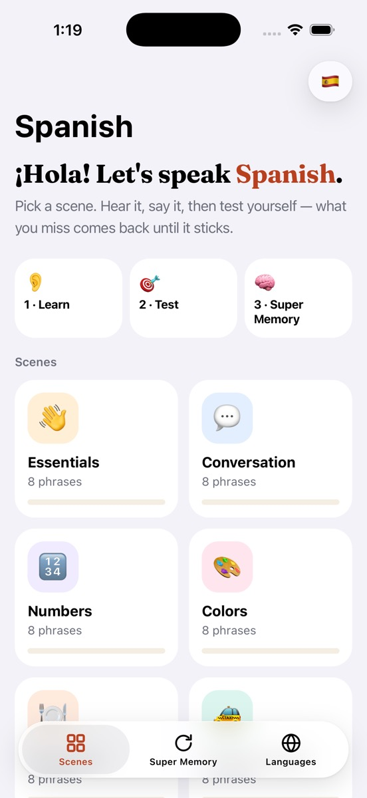
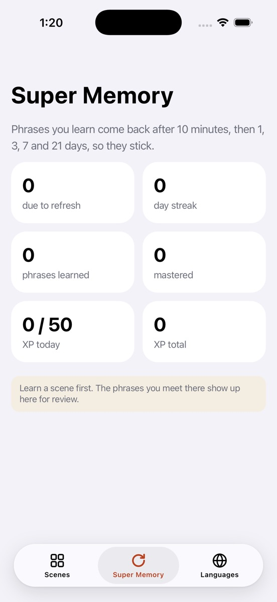
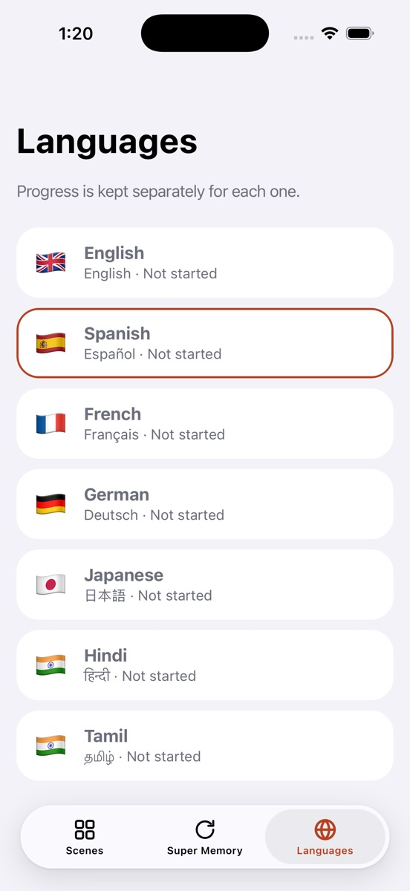
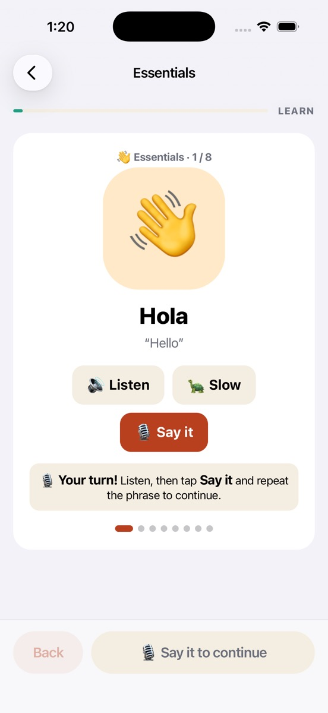
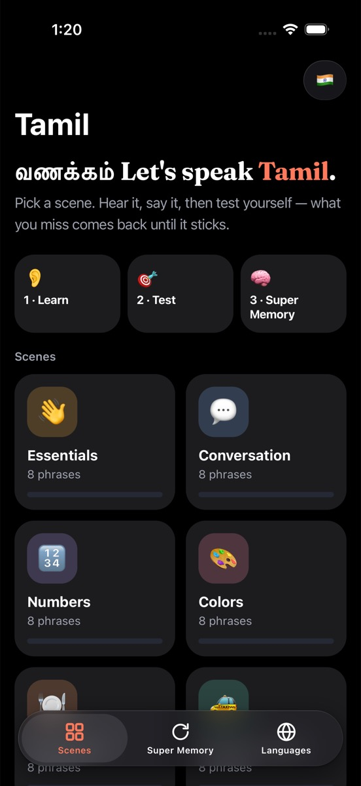

# Pesu for iPhone

A native SwiftUI shell (WKWebView, iOS 17+) around the live web app at https://pesu-phrases.vercel.app, generated from the
[Kolam iOS shell template](https://github.com/tgopinath/kolam-design-system/tree/main/ios/shell-template).
Inside this app the page switches to Apple's Human Interface Guidelines look (Kolam iOS kit: large titles,
Liquid Glass tab bar with Scenes, Super Memory and Languages, lessons full screen with a back button, haptics);
in Safari or any other browser it keeps its own look. Web app source: https://github.com/tgopinath/pesu

**Speech.** Read-aloud goes through a native `tts` message handler (`AVSpeechSynthesizer`) instead of Web Speech:
it plays with the ring/silent switch on (`AVAudioSession` `.playback`), uses every voice installed on the iPhone
(Spanish, French, German, Japanese, Hindi, Tamil, English), and tells the page when a phrase has finished.
The shell passes the installed voice languages in `window.KolamShell.ttsLangs` so the page can say when one is missing.

    

## Run it

```sh
xcodebuild -project *.xcodeproj -scheme $(basename *.xcodeproj .xcodeproj) \
  -destination 'platform=iOS Simulator,name=iPhone 17 Pro' -derivedDataPath build CODE_SIGNING_ALLOWED=NO build
```

Then install `build/Build/Products/Debug-iphonesimulator/*.app` with `xcrun simctl install booted …`.
Debug builds accept `-KolamStartURL "<url>"` (another route) and `-KolamJS "<line>"` (runs once after loading, for screenshot set-up) on `simctl launch`.
Installing on other people's iPhones needs TestFlight or the App Store (Apple Developer Program).
